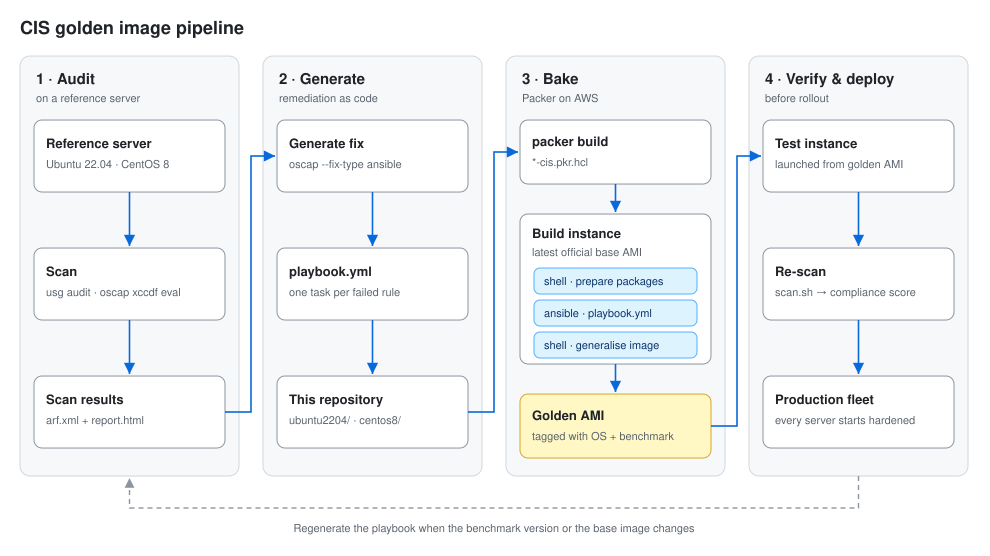
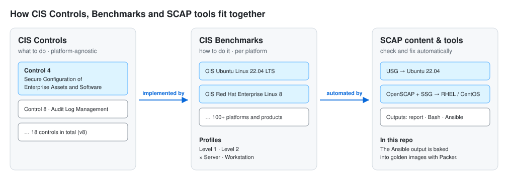
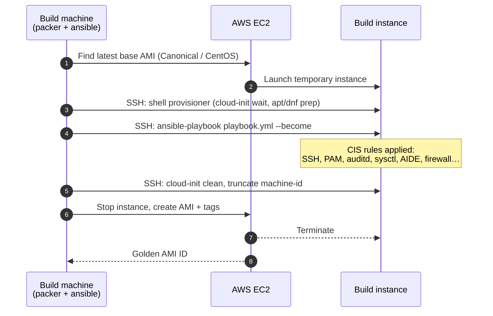

# CIS-Compliant Golden Images

Build hardened **golden images** for **Ubuntu 22.04** and **CentOS 8** that follow the [CIS Benchmarks](https://www.cisecurity.org/cis-benchmarks).

The workflow:

1. **Audit** a reference server with a SCAP scanner: [Ubuntu Security Guide (USG)](https://ubuntu.com/security/certifications/docs/usg) on Ubuntu, [OpenSCAP](https://www.open-scap.org/) on CentOS.
2. **Generate** an Ansible playbook that fixes every failed rule.
3. **Bake** that playbook into a machine image with **Packer**, so every server launched from it starts out hardened.
4. **Re-scan** to check the result.



| OS | Benchmark / profile | Tooling | Result |
|---|---|---|---|
| Ubuntu 22.04 | CIS Level 1 Server (`cis_level1_server`) | USG + OpenSCAP | Playbook in [`ubuntu2204/`](ubuntu2204/) |
| CentOS 8 | CIS RHEL 8 Level 2 Server (`cis`) | OpenSCAP + SCAP Security Guide | Playbook in [`centos8/`](centos8/), ~95% compliant after remediation |

---

## Contents

- [Repository layout](#repository-layout)
- [Background: CIS, OpenSCAP and USG](#background-cis-openscap-and-usg)
- [Quick start: build a golden image with Packer](#quick-start-build-a-golden-image-with-packer)
- [Ubuntu 22.04: step-by-step guide](#ubuntu-2204-step-by-step-guide)
- [CentOS 8: step-by-step guide](#centos-8-step-by-step-guide)
- [Notes and caveats](#notes-and-caveats)
- [References](#references)

## Repository layout

```
.
├── requirements.yml              # Ansible collections the playbooks need
├── docs/images/                  # Architecture diagrams used in this README
├── ubuntu2204/
│   ├── playbook.yml              # Generated from a CIS Level 1 Server audit
│   ├── ubuntu2204-cis.pkr.hcl    # Packer template (AWS, amazon-ebs)
│   └── scan.sh                   # Audit a host and write HTML/ARF reports
└── centos8/
    ├── playbook.yml              # Generated from a CIS Level 2 Server audit
    ├── centos8-cis.pkr.hcl       # Packer template (AWS, amazon-ebs)
    └── scan.sh                   # Audit a host (includes the CentOS CPE fix)
```

---

## Background: CIS, OpenSCAP and USG

### What is CIS?

The [Center for Internet Security (CIS)](https://www.cisecurity.org/) is a nonprofit organization that develops and publishes secure configuration benchmarks and automated configuration assessment tools. It also certifies security products that help organizations improve their security posture.

### CIS Controls

The [CIS Critical Security Controls](https://www.cisecurity.org/controls) are a prioritized set of actions for cyber defense that give specific, actionable ways to stop the most common attacks. They are a short list of high-priority, highly effective defensive actions: a "must-do, do-first" starting point for any organization improving its cyber defense.

### CIS Benchmarks

[CIS Benchmarks](https://www.cisecurity.org/cis-benchmarks) are hardening guidelines for specific operating systems, middleware, applications and network devices. They are prescriptive: each recommendation names a specific setting to review and set in the product.

**How they relate:** the CIS Controls say *what* an organization should do (for example "securely configure enterprise assets"). The CIS Benchmarks say *how* to do it on a specific platform (for example "set `PermitRootLogin no` in `sshd_config` on Ubuntu 22.04"). SCAP tools such as USG and OpenSCAP then check and apply the benchmark settings automatically.



Each benchmark has profiles:

- **Level 1**: essential hardening with little impact on usability.
- **Level 2**: defense in depth for high-security environments. It removes more attack surface but may break some functionality.
- **Server** and **Workstation** variants of each level.

### OpenSCAP

[OpenSCAP](https://www.open-scap.org/) is an open-source set of tools for assessing, measuring and enforcing security baselines. It is built on **SCAP** (Security Content Automation Protocol), a set of open standards for listing software flaws and security-related configuration issues and checking for them automatically.

Organizations need to monitor their systems continuously, apply security updates and keep configurations hardened. OpenSCAP scans a host against a SCAP profile (such as CIS), produces HTML/XML reports, and can **generate remediation** as a Bash script or an Ansible playbook.

### Ubuntu Security Guide (USG)

The [Ubuntu Security Guide](https://ubuntu.com/security/certifications/docs/usg) is Canonical's tool for auditing and hardening Ubuntu against CIS and DISA-STIG profiles. It is built on OpenSCAP and ships Ubuntu-specific SCAP content. USG is part of **Ubuntu Pro**, which is free for personal use on up to 5 machines.

Since we target Ubuntu 22.04, we use USG for the Ubuntu image and plain OpenSCAP for CentOS.

---

## Quick start: build a golden image with Packer

The playbooks in this repo are already generated, so you can go straight to building an image.

### Prerequisites

- [Packer](https://developer.hashicorp.com/packer/install) ≥ 1.10
- [Ansible](https://docs.ansible.com/ansible/latest/installation_guide/) on the build machine. The playbooks run over SSH, so Ansible is **not** installed in the image.
- AWS credentials allowed to launch EC2 instances and create AMIs (`AWS_PROFILE` or `AWS_ACCESS_KEY_ID`/`AWS_SECRET_ACCESS_KEY`)

### Build

```bash
# Ubuntu 22.04: CIS Level 1 Server
packer init  ubuntu2204/
packer build ubuntu2204/

# CentOS 8: CIS Level 2 Server
packer init  centos8/
packer build centos8/
```

To override defaults:

```bash
packer build -var region=eu-west-1 -var instance_type=t3.large ubuntu2204/
```

| Variable | Default | Description |
|---|---|---|
| `region` | `us-east-1` | AWS region to build in |
| `instance_type` | `t3.medium` | Temporary build instance size |
| `ami_prefix` | `ubuntu2204-cis-l1` / `centos8-cis-l2` | Prefix of the resulting AMI name |
| `source_ami_name` | `CentOS 8*x86_64*` | *(CentOS only)* Base AMI name filter |

What Packer does:

1. Launches the latest official base AMI (Canonical or the CentOS project).
2. Prepares the package manager. On Ubuntu it waits for cloud-init. On CentOS it points dnf at `vault.centos.org`, because CentOS 8 is end-of-life.
3. Runs `playbook.yml` with the Ansible provisioner using `--become`.
4. Cleans cloud-init state and `machine-id` so each instance boots with a fresh identity.
5. Saves the AMI with tags showing the OS and benchmark.



> To target another platform (VMware, Azure, GCP, QEMU), replace the `source` block. The provisioners stay the same.

### Run the playbooks without Packer

To harden an existing server:

```bash
ansible-galaxy collection install -r requirements.yml

# On the server itself
sudo ansible-playbook -i localhost, -c local ubuntu2204/playbook.yml

# Against remote servers
ansible-playbook -i inventory.ini --become centos8/playbook.yml
```

---

## Ubuntu 22.04: step-by-step guide

This is how [`ubuntu2204/playbook.yml`](ubuntu2204/playbook.yml) was produced. Repeat it to regenerate the playbook for a newer benchmark version or a different profile.

### Step 1: Install the Ubuntu Pro client

```bash
sudo apt update
sudo apt install ubuntu-advantage-tools
```

### Step 2: Attach your Ubuntu Pro subscription

USG requires an Ubuntu Pro subscription. Get a token from [ubuntu.com/pro](https://ubuntu.com/pro) (free for personal use), then attach it:

```bash
sudo pro attach <your_pro_token>
```

### Step 3: Install USG

```bash
sudo pro enable usg
sudo apt install usg
```

### Step 4: Audit the system

```bash
sudo usg audit cis_level1_server
```

`cis_level1_server` is the USG **profile**. Profiles match the CIS profiles: `cis_level1_server`, `cis_level2_server`, `cis_level1_workstation` and `cis_level2_workstation`. A higher level adds more rules, which further reduce attack surface at some cost to usability.

The audit writes HTML and XML reports to `/var/lib/usg/`. The HTML report lists every rule that passed or failed.

To choose where the reports go, call OpenSCAP directly. The CIS content lives in `/usr/share/ubuntu-scap-security-guides/1/benchmarks/`:

```bash
sudo oscap xccdf eval \
  --profile xccdf_org.ssgproject.content_profile_cis_level1_server \
  --results-arf /tmp/arf.xml \
  --report /tmp/report.html \
  /usr/share/ubuntu-scap-security-guides/1/benchmarks/ssg-ubuntu2204-ds.xml
```

[`ubuntu2204/scan.sh`](ubuntu2204/scan.sh) wraps this command.

### Step 5: Remediate

USG offers three ways to bring a system into compliance:

**Option A: Fix one server in place**

```bash
sudo usg fix cis_level1_server
```

Best when you only need to secure a single server.

**Option B: Generate a Bash script for many servers**

You can't always install USG on every system that needs to comply. For those, generate a script and run it on each host:

```bash
sudo usg generate-fix cis_level1_server --output fix.sh
```

**Option C: Generate an Ansible playbook (used for golden images)**

A golden image needs the controls applied to the image itself, so we generate an **Ansible playbook** and run it from Packer. Use the results file produced in Step 4:

```bash
sudo oscap xccdf generate fix \
  --fix-type ansible \
  --result-id "" \
  /var/lib/usg/usg-results-<timestamp>.xml > playbook.yml
sudo chown "$USER": playbook.yml
```

> The generated playbook starts with `hosts: all`. Keep it that way for Packer. To run it on the local machine, use `-i localhost, -c local` instead of editing the file.

### Step 6: Apply the playbook

```bash
sudo ansible-playbook -i localhost, -c local playbook.yml
```

Or copy it to [`ubuntu2204/playbook.yml`](ubuntu2204/playbook.yml) and build the image as described in the [quick start](#quick-start-build-a-golden-image-with-packer).

### Step 7: Re-scan

Run Step 4 again and compare the reports. Most previously failed rules should now pass. The rest usually need a manual decision, such as partitioning (`/tmp`, `/var`, `/var/log` on separate filesystems) or bootloader passwords.

To go further, download the full [CIS Ubuntu Linux 22.04 LTS Benchmark](https://www.cisecurity.org/benchmark/ubuntu_linux) and review the manual recommendations.

---

## CentOS 8: step-by-step guide

This is how [`centos8/playbook.yml`](centos8/playbook.yml) was produced. CentOS has no USG, so we use OpenSCAP with the **SCAP Security Guide (SSG)**. SSG ships content for **RHEL 8**, which we adapt to CentOS.

### Step 1: Install OpenSCAP and SSG

```bash
sudo yum update
sudo yum install openscap-scanner scap-security-guide
```

### Step 2: First scan, and why it shows "notapplicable"

```bash
sudo oscap xccdf eval \
  --profile xccdf_org.ssgproject.content_profile_ospp \
  --report /tmp/report.html \
  /usr/share/xml/scap/ssg/content/ssg-rhel8-ds.xml
```

Every rule comes back as **`notapplicable`**. The RHEL 8 content checks the platform CPE (`cpe:/o:redhat:enterprise_linux:8`), and CentOS doesn't match it.

### Step 3: Update the OpenSCAP CPE dictionary

Back up the shipped CPE files and replace them with the upstream versions, which know about CentOS:

```bash
sudo cp /usr/share/openscap/cpe/openscap-cpe-dict.xml /usr/share/openscap/cpe/openscap-cpe-dict.xml.dist
sudo cp /usr/share/openscap/cpe/openscap-cpe-oval.xml /usr/share/openscap/cpe/openscap-cpe-oval.xml.dist

sudo curl -L https://raw.githubusercontent.com/OpenSCAP/openscap/maint-1.3/cpe/openscap-cpe-dict.xml \
  -o /usr/share/openscap/cpe/openscap-cpe-dict.xml
sudo curl -L https://raw.githubusercontent.com/OpenSCAP/openscap/maint-1.3/cpe/openscap-cpe-oval.xml \
  -o /usr/share/openscap/cpe/openscap-cpe-oval.xml
```

### Step 4: Point the SSG content at CentOS

The datastream still only references RHEL, so this step is also needed. Replace the RHEL platform identifiers with CentOS ones:

```bash
sudo sed -i \
  -e 's|idref="cpe:/o:redhat:enterprise_linux|idref="cpe:/o:centos:centos|g' \
  -e 's|ref_id="cpe:/o:redhat:enterprise_linux|ref_id="cpe:/o:centos:centos|g' \
  /usr/share/xml/scap/ssg/content/ssg-rhel*.xml
```

### Step 5: List the available profiles

```bash
oscap info /usr/share/xml/scap/ssg/content/ssg-rhel8-ds.xml
```

Look for `xccdf_org.ssgproject.content_profile_cis` (CIS Level 2 Server). Level 1 and workstation variants are also listed.

### Step 6: Scan against the CIS benchmark

Save both an HTML report and **ARF** results. You need the ARF file to generate the playbook.

```bash
sudo oscap xccdf eval \
  --oval-results \
  --profile xccdf_org.ssgproject.content_profile_cis \
  --results-arf /tmp/arf.xml \
  --report /tmp/report.html \
  /usr/share/xml/scap/ssg/content/ssg-rhel8-ds.xml
```

[`centos8/scan.sh`](centos8/scan.sh) runs Steps 1, 3, 4 and 6 in one go.

### Step 7: Generate the Ansible playbook

```bash
oscap xccdf generate fix --fix-type ansible --result-id "" /tmp/arf.xml > playbook.yml
```

### Step 8: Apply the playbook

Install Ansible if it isn't already present:

```bash
sudo yum install -y epel-release
sudo yum install -y ansible
```

Then run the playbook:

```bash
sudo ansible-playbook -i localhost, -c local playbook.yml
```

Or copy it to [`centos8/playbook.yml`](centos8/playbook.yml) and build the image with Packer.

### Step 9: Re-scan

```bash
sudo oscap xccdf eval \
  --oval-results \
  --profile xccdf_org.ssgproject.content_profile_cis \
  --results-arf /tmp/arf-after.xml \
  --report /tmp/report-after.html \
  /usr/share/xml/scap/ssg/content/ssg-rhel8-ds.xml
```

After remediation the server scored about **95%** compliant with the CIS profile.

---

## Notes and caveats

- **Test before production.** CIS Level 2 in particular changes SSH, PAM, auditd, kernel parameters and firewall settings. Launch a test instance from the image and confirm your workloads, SSH access and monitoring agents still work.
- **CentOS 8 is end-of-life** (December 2021) and receives no security updates. The CentOS material is kept as a reference. For new images, use **Rocky Linux 8/9** or **AlmaLinux 8/9**. The same OpenSCAP workflow applies, and recent SSG releases ship native content for both.
- **Generated playbooks are snapshots.** They fix only the rules that failed on the reference machine, with the benchmark version installed at the time (OpenSCAP 1.2.17 for Ubuntu, 1.3.8 for CentOS). Regenerate them when the benchmark or base image changes.
- **Some controls can't be automated in an image,** such as separate partitions, a GRUB password and organization-specific banners. Handle them in the base image or launch template, or document them as accepted exceptions.
- **Scan reports may contain host details.** `.gitignore` excludes `*.html` and ARF files so they aren't committed by accident.

## References

- [CIS Benchmarks](https://www.cisecurity.org/cis-benchmarks)
- [CIS Critical Security Controls](https://www.cisecurity.org/controls)
- [Ubuntu Security Guide documentation](https://ubuntu.com/security/certifications/docs/usg)
- [OpenSCAP](https://www.open-scap.org/) and the [ComplianceAsCode / SCAP Security Guide](https://github.com/ComplianceAsCode/content) project
- [Packer Ansible provisioner](https://developer.hashicorp.com/packer/integrations/hashicorp/ansible/latest/components/provisioner/ansible)
- [Packer Amazon EBS builder](https://developer.hashicorp.com/packer/integrations/hashicorp/amazon/latest/components/builder/ebs)
